# 🐦‍🔥 Phoenix

**Phoenix is the platform. Fawkes is the pet.**

Phoenix is an open-source developer companion. It connects your developer tools, meetings and AI agents through a common event and capability architecture, and shows what is happening through **Fawkes**, an animated pet that lives in your navbar or floats on your desktop.



The first capability is **Kage**, which handles meeting capture, transcription, summaries and archiving.

> Status: unreleased and in active development. Phoenix includes the Core runtime, web app, Tauri desktop companion, AI services and integrations across the [97-phase roadmap](docs/phases/TRACKER.md). Implementation and release verification are separate: passing unit and simulated integration tests does not establish real-device or real-service support. The [gap register](docs/gaps.md) tracks unresolved limits; component documents record the evidence for each feature. The [verification checklist](docs/release/local-verification.md) covers the next practical checks. No release readiness is implied.

## Repository layout

| Path            | Contents                                                                     |
| --------------- | ---------------------------------------------------------------------------- |
| `protocol/`     | Versioned event schema, error codes, Fawkes state definitions                |
| `core/`         | Phoenix Core: config, logging, persistence, event bus, state engine, runtime |
| `pet/`          | Fawkes runtime, states, animations and assets                                |
| `apps/`         | `web` (navbar + Pet Panel) and `desktop` (floating Fawkes or island)         |
| `sdk/`          | Capability SDK                                                               |
| `capabilities/` | First-party capabilities, e.g. Kage, Git, GitHub, terminal, Docker, Frappe   |
| `docs/`         | Vision, phases, ADRs, contracts                                              |

## Getting started

Requires Node.js ≥ 22.13 and pnpm 10.

```sh
pnpm install
pnpm check        # typecheck + lint + tests
pnpm start        # build the web app and start Phoenix Core
```

Open <http://127.0.0.1:4870>. Fawkes lives in the top bar; click it for the Pet Panel. Set up capabilities (Git repositories, your Kage server and API key) under **Settings**.

For UI development with hot reload, run `pnpm dev:core` in one terminal and `pnpm dev:web` in another, then open <http://localhost:5173> (the Vite dev server proxies the API and picks up the core's session token).

The floating desktop Fawkes (Phase 14, in progress) and the optional notch/top-edge island (Phase 60, run on a Mac without a notch only) are a Tauri v2 app in `apps/desktop`. It needs Rust ≥ 1.90 and a running core:

```sh
pnpm dev:core
pnpm --filter @phoenix/desktop dev
```

Tools and scripts can call the API with the session token core writes to `.phoenix/dev/session.token`:

```sh
curl -H "Authorization: Bearer $(cat .phoenix/dev/session.token)" http://127.0.0.1:4870/api/pet/state
```

## Privacy

Phoenix is local-first. Everything it stores lives in its data directory on your computer (`.phoenix/<env>/`); credentials such as API keys live in your OS keychain. **Phoenix sends no telemetry.** AI features are optional and off by default. When you turn them on, a local Ollama model processes data on this device; a cloud provider is used only if you have configured it, added your own key, and granted the matching opt-ins, and sensitive data classes (for example meeting content) are never sent to the cloud by default. Only the built-in Ollama integration is treated as trusted local for sensitive data; other local servers such as LM Studio are not. Dictation clean-up, call summaries and questions about attached files are never sent to a cloud provider. Known limit: the external-AI permission and the opt-ins are protected by the local session token only, so another program running as your user that can read that token could switch them on (see the [gap register](docs/gaps.md)). Dictation and recording are off by default; dictation keeps audio in memory and recognises it on your computer. **Settings → Privacy and data** shows what is stored, sets how long each kind is kept, and deletes it. The audit log of permissions, approvals and deletions is kept for accountability.

## Documentation

- [Vision documents](docs/vision/)
- [Phase tracker](docs/phases/TRACKER.md)
- [Architecture decisions](docs/adr/README.md)
- [Event protocol v1](docs/protocol/events-v1.md)
- [Architecture](docs/architecture.md)
- [Security review](docs/security-review.md)
- [Known gaps and unverified claims](docs/gaps.md)
- [Release gates for AI features](docs/release-gates.md)
- [Developer preview programme](docs/preview/programme.md) (a plan, not a record of completed stages)
- [v1.0 verification plan](docs/release/v1-verification.md) and [v2.0 verification plan](docs/release/v2-verification.md) (plans and decisions, not releases)
- [Capability SDK docs](docs/capabilities/) and the local [0.1.0 static docs snapshot](docs/capabilities/site/0.1.0/index.html) (not hosted or published)
- [« OK Fawkes » voice assistant](docs/voice-assistant.md), [demo mode](docs/demo-mode.md) and the [interface languages](apps/web/src/i18n/README.md) (all non-English text is machine-generated and unreviewed)
- [Phone link](docs/phone-link.md) (Core side only, no phone app exists), the [keep-awake helper and recovery journal](docs/awake-helper.md) and [lid-close actions](docs/awake-lid-actions.md) (built and tested with fakes and simulations; the helper was never installed or run with root)
- [MCP server and approval channel](docs/mcp-server.md) (tested with a simulated client only; no real MCP client was run), [agent safety net](docs/agent-safety-net.md) (checkpoints, rollback, loop and stall warnings; no real agent session was rolled back), [Mission Control and cost meter](docs/mission-control.md) (no provider figure was compared), [handoff notes and secret guard](docs/handoff-and-secret-guard.md) (never run in a real agent or against a real PR) and the [port and process radar](docs/port-radar.md) (macOS listing read once; no process was ever signalled)
- [Machine health and local models](docs/machine-health.md) (Ollama and LM Studio on loopback; downloads refuse until a trusted size catalog exists), [engineering signals](docs/engineering-signals.md) (advisory provider always unavailable; opt-in screen fake-tested only), [calendar awareness and meeting prep](docs/calendar-awareness.md) (no provider connected in production; deploy freeze is opt-in), the [standup and end-of-day digest](docs/daily-digest.md) (copy plus confirmation-gated Slack send with a fake transport; no Teams/Discord send) and [focus mode and screenshot-to-issue](docs/focus-and-screenshot.md) (manual/Pomodoro Focus Mode wired; macOS region capture feeds a mounted screenshot-to-issue, fake-tested only, never run on a real Mac; text-only Linear and Jira issue creation exists as confirmed `issues` commands, see [creating tasks](docs/capabilities/creating-tasks.md), with no real tracker contacted); all built and tested with fakes and simulations only
- Phases 86–96: [chat approvals](docs/chat-approvals.md), [remote relay](docs/remote-relay.md), [status lights](docs/status-lights.md), [CLI](docs/phoenix-cli.md), [scheduled awake](docs/scheduled-awake.md), [Fawkes rebirth](docs/fawkes-rebirth.md), [team status](docs/team-status.md), [mini browser](docs/mini-browser.md), [music connectors](docs/youtube-music.md), [browsing assistant](docs/browsing-assistant.md) and [browser profiles](docs/browser-profiles.md). The browser has a Rust host, a tab/address-bar UI and a Core action relay; native webview behavior still requires real-display verification. Consult these component documents for implemented behavior and outstanding platform/service checks.

## License

Phoenix is free software, licensed under the [GNU General Public License v3.0](LICENSE).
