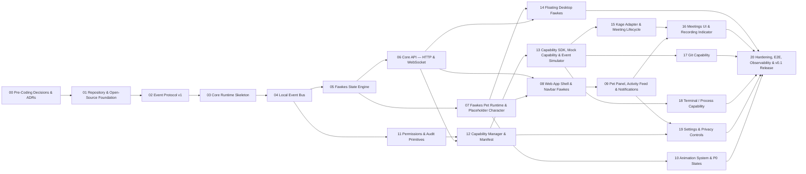

# Phoenix Phase Tracker

Single source of truth for delivery progress. Derived from the five vision documents in [`docs/vision/`](../vision/).

**Status legend:** ⬜ Not started · 🟨 In progress · ✅ Done · ⛔ Blocked

**How to use:** when a phase starts, change its status here *and* in the phase file. A phase is ✅ only when every exit criterion in its file is checked. Do not start a new stage until the stage gate above it is met — the roadmap advances on technical gates, not calendar dates.

## Current focus

Unreleased prerequisites still begin with **Phase 14 — floating desktop Fawkes** (needs a person at an unlocked screen) and **Phase 20 — hardening & v0.1 release**. Phases 21–55 contain substantial implemented work, and Phases 56–60 are built and unit-tested but have not been run against a real coding agent, a notch Mac, a Linux compositor or Windows. No release tag from v0.1 onward has been cut, and many release gates need real services, hardware, independent review or an owner decision (see [gaps](../gaps.md)).

New parity track (2026-10-15): the [Coucou & Insomnia audit](../audits/coucou-insomnia-audit.md) maps every feature of both projects to Phoenix and adds **Stage 12 (phases 56–71)** and **Stage 13 (phases 72–75)**. Build order started with **Phase 56 — agent approvals from Fawkes** (phases 56–60 are now built, none with its exit criteria met) and continues with **Phase 72 — keep-awake sessions**, which needs nothing from the open v0.1 items. Stages 14–15 (2026-10-15) add [Phoenix originals and the Phoenix browser](../audits/phoenix-originals-and-browser.md): phases 76–96.

## Summary

| Stage | Release | Phases | Done |
|---|---|---|---|
| Stage 1 — MVP Foundation | v0.1 | 00–20 (21) | 18/21 |
| Stage 2 — Useful Fawkes (v0.2) | v0.2 | 21–26 (6) | 0/6 |
| Stage 3 — Memory & Context (v0.3) | v0.3 | 27–29 (3) | 0/3 |
| Stage 4 — Fawkes Becomes an Agent (v0.4) | v0.4 | 30–33 (4) | 2/4 |
| Stage 5 — Developer-Agent Orchestration (v0.5) | v0.5 | 34 (1) | 0/1 |
| Stage 6 — Meeting → Engineering (v0.6) | v0.6 | 35–36 (2) | 0/2 |
| Stage 7 — Knowledge Graph (v0.7) | v0.7 | 37–38 (2) | 1/2 |
| Stage 8 — Automation & Workflows (v0.8) | v0.8 | 39–40 (2) | 0/2 |
| Stage 9 — Capability Ecosystem (v0.9) | v0.9 | 41–42 (2) | 0/2 |
| Stage 10 — Developer Operating Layer (v1.0) | v1.0 | 43–44 (2) | 0/2 |
| Stage 11 — AI Evolution (v1.1 → v2.0) | v1.1 → v2.0 | 45–55 (11) | 0/11 |
| Stage 12 — Coucou parity and beyond | post-v2.0 | 56–71 (16) | 0/16 |
| Stage 13 — Insomnia parity and beyond | post-v2.0 | 72–75 (4) | 0/4 |
| Stage 14 — Phoenix originals | post-v2.0 | 76–92 (17) | 0/17 |
| Stage 15 — Phoenix browser | post-v2.0 | 93–96 (4) | 0/4 |
| **Total** | | **97** | **21/97** |

## Stage 1 — MVP Foundation

| # | Phase | Release | Priority | Depends on | Status | Owner | Notes |
|---|---|---|---|---|---|---|---|
| 00 | [Pre-Coding Decisions & ADRs](phase-00-decisions-and-adrs.md) | v0.1 | Critical | — | 🟨 | | Desktop spike open (Kage contract reconciled in Phase 15) |
| 01 | [Repository & Open-Source Foundation](phase-01-repo-and-open-source-foundation.md) | v0.1 | Critical | 00 | ✅ | | |
| 02 | [Event Protocol v1](phase-02-event-protocol-v1.md) | v0.1 | Critical | 01 | ✅ | | |
| 03 | [Core Runtime Skeleton](phase-03-core-runtime-skeleton.md) | v0.1 | Critical | 02 | ✅ | | |
| 04 | [Local Event Bus](phase-04-event-bus.md) | v0.1 | Critical | 03 | ✅ | | |
| 05 | [Fawkes State Engine](phase-05-state-engine.md) | v0.1 | Critical | 04 | ✅ | | |
| 06 | [Core API — HTTP & WebSocket](phase-06-core-api-http-websocket.md) | v0.1 | Critical | 05 | ✅ | | |
| 07 | [Fawkes Pet Runtime & Placeholder Character](phase-07-fawkes-pet-runtime.md) | v0.1 | Critical | 05 | ✅ | | |
| 08 | [Web App Shell & Navbar Fawkes](phase-08-web-shell-navbar-fawkes.md) | v0.1 | Critical | 06, 07 | ✅ | | |
| 09 | [Pet Panel, Activity Feed & Notifications](phase-09-pet-panel-activity-notifications.md) | v0.1 | Critical | 08 | ✅ | | |
| 10 | [Animation System & P0 States](phase-10-animation-system-p0-states.md) | v0.1 | High | 07 | ✅ | | |
| 11 | [Permissions & Audit Primitives](phase-11-permissions-and-audit.md) | v0.1 | Critical | 04 | ✅ | | |
| 12 | [Capability Manager & Manifest](phase-12-capability-manager.md) | v0.1 | Critical | 11, 06 | ✅ | | |
| 13 | [Capability SDK, Mock Capability & Event Simulator](phase-13-capability-sdk-mock-simulator.md) | v0.1 | Critical | 12 | ✅ | | |
| 14 | [Floating Desktop Fawkes](phase-14-floating-desktop-fawkes.md) | v0.1 | High | 07, 06 | 🟨 | | Works on macOS (window, drag, tray incl. "Open Phoenix", keep-on-top, start-on-login checked on a real desktop); window/tray lifecycle now automated on the mock runtime; multi-monitor, Linux and Windows not verified ([gaps](../gaps.md)) |
| 15 | [Kage Adapter & Meeting Lifecycle](phase-15-kage-adapter-meeting-lifecycle.md) | v0.1 | Critical | 13 | ✅ | | |
| 16 | [Meetings UI & Recording Indicator](phase-16-meetings-ui.md) | v0.1 | Critical | 15, 09 | ✅ | | |
| 17 | [Git Capability](phase-17-git-capability.md) | v0.1 | High | 13 | ✅ | | |
| 18 | [Terminal / Process Capability](phase-18-terminal-process-capability.md) | v0.1 | High | 13 | ✅ | | |
| 19 | [Settings & Privacy Controls](phase-19-settings-and-privacy.md) | v0.1 | High | 09, 12 | ✅ | | |
| 20 | [Hardening, E2E, Observability & v0.1 Release](phase-20-hardening-and-v0-1-release.md) | v0.1 | Critical | 14, 16, 17, 18, 19, 10 | 🟨 | | Security review, E2E, diagnostics, desktop CI, dependency scan and a real-Kage run (all but the live Meet capture and AI summaries) done; packaging and release tag open |

**Stage gate:** PRD v2.0 §30 Definition of Done met; core event/state/pet loop stable.

## Stage 2 — Useful Fawkes (v0.2)

| # | Phase | Release | Priority | Depends on | Status | Owner | Notes |
|---|---|---|---|---|---|---|---|
| 21 | [Post-MVP Stabilisation](phase-21-post-mvp-stabilization.md) | v0.2 | Critical | 20 | 🟨 | | Started early on decision-free items: hostile-event robustness test, repeated-failure notification noise; telemetry is blocked on a decision |
| 22 | [GitHub & CI/CD Capability](phase-22-github-and-cicd-capability.md) | v0.2 | High | 21 | ✅ | | Real failed CI run mapped to ERROR with its link; review and deployment events only against mocks. Gaps: [gaps.md](../gaps.md) |
| 23 | [Frappe / ERPNext Capability](phase-23-frappe-erpnext-capability.md) | v0.2 | High | 21 | 🟨 | | Discovery, health and site ERROR done; build/migration/deploy/restart events not possible read-only; never run against a real site |
| 24 | [Docker & Editor Capabilities](phase-24-docker-and-editor-capabilities.md) | v0.2 | Medium | 21 | 🟨 | | Docker run against a real daemon; VS Code extension never loaded in a real VS Code; build events not observable |
| 25 | [Coding-Agent Lifecycle Events](phase-25-coding-agent-lifecycle-events.md) | v0.2 | High | 21 | 🟨 | | Observe-only; hook adapter built from the Claude Code binary's strings, never driven by a live session; Pet Panel Overview lists reported agents |
| 26 | [Issue Tracker Capabilities & v0.2 Release](phase-26-issue-tracker-capabilities.md) | v0.2 | Medium | 22, 23, 24, 25 | 🟨 | | Issues capability (GitHub real, Linear/Jira docs-only); v0.2 gate test passes; release not cut |

**Stage gate:** Multiple integrations operate through the capability model.

## Stage 3 — Memory & Context (v0.3)

| # | Phase | Release | Priority | Depends on | Status | Owner | Notes |
|---|---|---|---|---|---|---|---|
| 27 | [Model Adapter & Router](phase-27-model-adapter-and-router.md) | v0.3 | High | 26 | 🟨 | | Ollama run for real; Anthropic never contacted; AI off by default |
| 28 | [Context Engine & Basic Memory Store](phase-28-context-engine-and-memory-store.md) | v0.3 | High | 27 | 🟨 | | Lexical memory + context engine; ran on this repo's real history and real Ollama |
| 29 | [Memory Governance & Inspection UX](phase-29-memory-governance-ux.md) | v0.3 | High | 28 | 🟨 | | Memory UI checked in a real browser; sensitive cloud opt-in is deliberate and audited; v0.3 not released |

**Stage gate:** Memory is permission-aware and inspectable.

## Stage 4 — Fawkes Becomes an Agent (v0.4)

| # | Phase | Release | Priority | Depends on | Status | Owner | Notes |
|---|---|---|---|---|---|---|---|
| 30 | [Policy Gateway & Tool Gateway](phase-30-policy-and-tool-gateway.md) | v0.4 | Critical | 29 | 🟨 | | Policy + tool gateway built and constructed in Core; no agent uses it yet (Phase 31) |
| 31 | [Agent Runtime & First Vertical Slice](phase-31-agent-runtime-first-vertical-slice.md) | v0.4 | Critical | 30 | ✅ | | Agent runtime and CI-failure agent; real GitHub, git and Ollama runs; found and fixed a commit-causality defect; gaps in gaps.md |
| 32 | [Fawkes Chat & Approval UX](phase-32-fawkes-chat-and-approval-ux.md) | v0.4 | High | 31 | ✅ | | Chat, current task, approval cards, automation setting; tested with fakes plus a real-browser check; gaps in gaps.md |
| 33 | [AI Evaluation Harness & v0.4 Release](phase-33-ai-evaluation-harness.md) | v0.4 | High | 31 | 🟨 | | Harness and 66 offline scenarios; v0.4 gate PASSES after D1-D3 were fixed; release not cut (owner sign-off); 3 criteria open |

**Stage gate:** Agent actions are controlled and auditable.

## Stage 5 — Developer-Agent Orchestration (v0.5)

| # | Phase | Release | Priority | Depends on | Status | Owner | Notes |
|---|---|---|---|---|---|---|---|
| 34 | [Coding-Agent Orchestration](phase-34-coding-agent-orchestration.md) | v0.5 | High | 33, 25 | 🟨 | | Built; verified against a fake agent and a real Core; never run against a real coding agent; v0.5 not cut |

**Stage gate:** Agent lifecycle and external events can be correlated.

## Stage 6 — Meeting → Engineering (v0.6)

| # | Phase | Release | Priority | Depends on | Status | Owner | Notes |
|---|---|---|---|---|---|---|---|
| 35 | [Kage Decisions & Action-Item Extraction](phase-35-kage-decisions-and-action-items.md) | v0.6 | High | 33, 16 | 🟨 | | Extraction, review states, search/ask, review panel on the meeting page; real-model path not exercised in the browser; 1 criterion open |
| 36 | [Action Items → Engineering Tasks](phase-36-action-items-to-engineering-tasks.md) | v0.6 | High | 35, 22, 23 | 🟨 | | Plans and task creation wired into Core, user-only routes; web panel built; verified only against local GitHub/Frappe mocks; 2 criteria open |

**Stage gate:** Meeting artifacts can become structured engineering context.

## Stage 7 — Knowledge Graph (v0.7)

| # | Phase | Release | Priority | Depends on | Status | Owner | Notes |
|---|---|---|---|---|---|---|---|
| 37 | [Hybrid Retrieval (Lexical + Vector + Rerank)](phase-37-hybrid-retrieval.md) | v0.7 | High | 36 | ✅ | | Local-only hybrid retrieval with explicit rebuild; recall@5 up, MRR gain within noise; real cold-rebuild verification pending |
| 38 | [Knowledge Graph & Provenance](phase-38-knowledge-graph-and-provenance.md) | v0.7 | High | 37 | 🟨 | | Graph, provenance view and verified-target mentions built; pre-registered value gate NOT met by the graph alone; 2 criteria open: the gate and the release |

**Stage gate:** Graph/hybrid retrieval proves measurable value.

## Stage 8 — Automation & Workflows (v0.8)

| # | Phase | Release | Priority | Depends on | Status | Owner | Notes |
|---|---|---|---|---|---|---|---|
| 39 | [Workflow Engine](phase-39-workflow-engine.md) | v0.8 | High | 38 | 🟨 | | Engine and user-owned history retention wired into Core; web definition editor uses atomic create-only/expected-hash save; release evidence open |
| 40 | [Workflow Safety & v0.8 Release](phase-40-workflow-safety.md) | v0.8 | High | 39 | 🟨 | | Safety layer wired into Core (user-only authorise, kill switch, restart reconciliation); v0.8 not cut; 2 criteria open |

**Stage gate:** Workflow execution is reliable and safe.

## Stage 9 — Capability Ecosystem (v0.9)

| # | Phase | Release | Priority | Depends on | Status | Owner | Notes |
|---|---|---|---|---|---|---|---|
| 41 | [SDK Stabilisation & Developer Docs](phase-41-sdk-stabilization-and-docs.md) | v0.9 | High | 40 | 🟨 | | Local packed ESM/TS SDK and isolated consumer/compat fixtures plus versioned static docs; independent onboarding/hosting/publication absent |
| 42 | [Capability Registry & v0.9 Release](phase-42-capability-registry.md) | v0.9 | High | 41 | 🟨 | | Host-verified signer ID/digest shown separately from artifact trust; third-party install refuses without OS sandbox; v0.9 not cut |

**Stage gate:** SDK/ecosystem and core are stable enough for external users.

## Stage 10 — Developer Operating Layer (v1.0)

| # | Phase | Release | Priority | Depends on | Status | Owner | Notes |
|---|---|---|---|---|---|---|---|
| 43 | [Developer Preview Programme](phase-43-developer-preview-program.md) | v1.0 | High | 42 | 🟨 | | Bundle, stage gates, feedback loop and release checklist documented; no cohort or preview artifact released |
| 44 | [v1.0 — Developer Operating Layer Release](phase-44-v1-0-operating-layer-release.md) | v1.0 | Critical | 43 | 🟨 | | Compatibility and v1 verification plan; human L2–L3 evidence, beta and independent sign-offs missing; no v1.0 tag |

**Stage gate:** v1.0 capability set stable; AI reliably at L2–L3.

## Stage 11 — AI Evolution (v1.1 → v2.0)

| # | Phase | Release | Priority | Depends on | Status | Owner | Notes |
|---|---|---|---|---|---|---|---|
| 45 | [Cross-Device Context & Sync](phase-45-cross-device-context.md) | v1.1 | Medium | 44 | 🟨 | | Encrypted staged records plus explicit reduced-motion/search-limit adapters and conflict-safe apply; no relay/device revocation/replay checkpoint |
| 46 | [Personal Knowledge Engine](phase-46-personal-knowledge-engine.md) | v1.2 | High | 45 | 🟨 | | Typed PR/CI/deploy/issue event metadata with deletion cascade and classified answers; other vetted sources and real-model corpus missing |
| 47 | [Multi-Agent Runtime](phase-47-multi-agent-runtime.md) | v1.3 | High | 46 | 🟨 | | CI, meeting review and aggregate-only planning review under typed grants; real specialist chain and v1.3 evaluation absent |
| 48 | [Phoenix World Model](phase-48-world-model.md) | v1.4 | Medium | 47 | 🟨 | | Append-only surviving temporal provenance and sourced association UI; complete real incident chain/causality absent |
| 49 | [Controlled Autonomous Agents](phase-49-controlled-autonomy.md) | v1.5 | High | 48 | 🟨 | | Settings/budgets/stop implemented; executable autonomy and CI→PR runner refused without OS sandbox; gate not met |
| 50 | [AI Capability Ecosystem](phase-50-ai-capability-ecosystem.md) | v1.6 | Medium | 49 | 🟨 | | Additive AI manifest metadata and explicit user disclosure; third-party install and cloud AI fail closed |
| 51 | [Agent-to-Agent Collaboration](phase-51-agent-to-agent-collaboration.md) | v1.7 | Medium | 50 | 🟨 | | Typed specialist delegation, intersection, conflict records and ancestry audit; no coding/test/devops specialists or v1.7 tag |
| 52 | [Predictive & Proactive Intelligence](phase-52-proactive-intelligence.md) | v1.8 | Medium | 51 | 🟨 | | Off-by-default consented Kage cadence with current-source/quiet/noise gates; no deploy/incident/dependency sources or user study |
| 53 | [Self-Improving Workflows & Evaluation Loop](phase-53-evaluation-feedback-loop.md) | v1.9 | Medium | 52 | 🟨 | | Digest-only durable feedback/candidate/evaluation/approval with forget cascade; no trusted task reader, pinned baseline or active consumer in Core |
| 54 | [Multimodal Interaction (Speech & Vision)](phase-54-multimodal-interaction.md) | v2.0 | Medium | 53 | 🟨 | | Local adapters plus Core-authorized one-shot mic/screen capture and Settings UI; installed models, device result and Fawkes voice unverified |
| 55 | [v2.0 — Ambient AI Operating Layer](phase-55-v2-0-ambient-ai-layer.md) | v2.0 | High | 54 | 🟨 | | 14 DoD + 8 anti-goal evidence plan, NO-GO; critical sandbox/preview/review/multimodal gates open |

**Stage gate:** v2.0 Definition of Done (AI Evolution §26) met.

## Stage 12 — Coucou parity and beyond

Every feature of [Coucou](https://github.com/Louis-CFM/coucou) (agents in the notch, approvals, dictation, notetaker, voice, services, phones) with Phoenix's own assets, plus Phoenix improvements. Scope, licensing rules and owner decisions: [Coucou & Insomnia audit](../audits/coucou-insomnia-audit.md).

| # | Phase | Release | Priority | Depends on | Status | Owner | Notes |
|---|---|---|---|---|---|---|---|
| 56 | [Agent Approvals & Questions from Fawkes](phase-56-agent-approvals-from-fawkes.md) | post-v2.0 | Critical | 25, 32, 34 | 🟨 | | Approval service, hook, Always/deny rules and cards built; tested against a scripted and an in-process Core; no real Claude Code or Codex session; Codex has no AskUserQuestion; card only in the web Pet Panel overview |
| 57 | [Universal Agent Relay & Hook Installers](phase-57-agent-relay-and-installers.md) | post-v2.0 | High | 56 | 🟨 | | Relay, installers and eight adapters built from public docs and tested on temp dirs; Hermes, Antigravity, Claude Desktop unsupported; no real agent installed; Windows pipe unverified |
| 58 | [Live Agent Sessions, Diffs & Plan Usage](phase-58-live-sessions-diffs-plan-usage.md) | post-v2.0 | High | 57 | 🟨 | | Steps, on-demand diffs, Claude plan usage with 80/95 % warnings, terminal jump and Markdown export built; Codex usage unsupported; no real agent, status JSON or terminal window verified |
| 59 | [Fawkes Interactions, Emotes & Sounds](phase-59-fawkes-interactions-and-sounds.md) | post-v2.0 | Medium | 10 | 🟨 | | Greeting, gaze, hover, poke, dizzy, completion jump and a procedural sound library with policy built and unit-tested; no sound played; sounds and desktop follow not wired into any host |
| 60 | [Fawkes Island (Notch / Top Edge) & Desktop Platforms](phase-60-fawkes-island.md) | post-v2.0 | Medium | 14 | 🟨 | | Island state machine, geometry, per-OS logic, mode switch and Windows credential backend built; run on a no-notch Mac only; no notch, Linux compositor or Windows run; CI matrix not yet run on GitHub |
| 61 | [Wardrobe, Per-Source Fawkes & Visible Capabilities](phase-61-wardrobe-and-per-source-fawkes.md) | post-v2.0 | Low | 59 | ⬜ | | |
| 62 | [Drop Files & Attach Windows as Context](phase-62-file-drop-and-window-context.md) | post-v2.0 | Medium | 32, 63 | ⬜ | | |
| 63 | [More AI Providers & Model Switcher](phase-63-more-ai-providers.md) | post-v2.0 | Medium | 27 | ⬜ | | |
| 64 | [Dictation Anywhere](phase-64-dictation-anywhere.md) | post-v2.0 | High | 54, 60 | ⬜ | | |
| 65 | [Botless Notetaker](phase-65-botless-notetaker.md) | post-v2.0 | High | 15, 35, 64 | ⬜ | | |
| 66 | [« OK Fawkes » Voice Assistant](phase-66-ok-fawkes-voice-assistant.md) | post-v2.0 | Medium | 54, 64 | ⬜ | | |
| 67 | [Service Integrations (Vercel, Stripe, n8n, Resend, Notion, Cal.com)](phase-67-service-integrations.md) | post-v2.0 | Medium | 13 | ⬜ | | |
| 68 | [Media & Portfolio Capabilities](phase-68-media-and-portfolio.md) | post-v2.0 | Low | 13 | ⬜ | | |
| 69 | [Weekly Recap & Statistics](phase-69-weekly-recap.md) | post-v2.0 | Low | 38 | ⬜ | | |
| 70 | [Shortcuts, Languages & Demo Mode](phase-70-shortcuts-i18n-demo.md) | post-v2.0 | Low | 19 | ⬜ | | |
| 71 | [Phone Link & Mobile Companions](phase-71-phone-link-and-mobile.md) | post-v2.0 | Medium | 45, 56 | ⬜ | | |

**Stage gate:** an agent's permission request is approved from Fawkes for real (56) and every shipped feature uses only Phoenix assets.

## Stage 13 — Insomnia parity and beyond (keep awake)

Every feature of [Insomnia](https://github.com/krishhgg/Insomnia) (timed keep-awake, lid-closed mode, recovery, lid actions, power floors, network failover), across macOS, Linux and Windows where the OS allows.

| # | Phase | Release | Priority | Depends on | Status | Owner | Notes |
|---|---|---|---|---|---|---|---|
| 72 | [Keep-Awake Sessions (No Root)](phase-72-keep-awake-sessions.md) | post-v2.0 | High | 13 | ⬜ | | |
| 73 | [Lid-Closed Mode, Recovery & Power Floors](phase-73-lid-closed-mode-and-recovery.md) | post-v2.0 | High | 72 | ⬜ | | |
| 74 | [Lid-Close Actions](phase-74-lid-close-actions.md) | post-v2.0 | Medium | 73 | ⬜ | | |
| 75 | [Agent Continuity: Network Failover, tmux Nudge, Browser Throttling](phase-75-agent-continuity-extras.md) | post-v2.0 | Low | 72, 34 | ⬜ | | |

**Stage gate:** every change a session makes is undone on every exit path, including a crash (recovery journal + backstop).

## Stage 14 — Phoenix originals

Features neither Coucou nor Insomnia has, built on Phoenix's own platform. Rationale: [Phoenix originals & browser proposal](../audits/phoenix-originals-and-browser.md).

| # | Phase | Release | Priority | Depends on | Status | Owner | Notes |
|---|---|---|---|---|---|---|---|
| 76 | [Phoenix MCP Server & Universal Approval Channel](phase-76-mcp-server-and-approval-channel.md) | post-v2.0 | High | 56, 30 | ⬜ | | |
| 77 | [Agent Safety Net: Checkpoints, Rollback, Loop & Stall Detection](phase-77-agent-safety-net.md) | post-v2.0 | High | 57 | ⬜ | | |
| 78 | [Agent Cost Meter & Mission Control](phase-78-agent-cost-and-mission-control.md) | post-v2.0 | Medium | 58 | ⬜ | | |
| 79 | [Session Handoff Notes & Secret Guard](phase-79-handoff-notes-and-secret-guard.md) | post-v2.0 | Medium | 58 | ⬜ | | |
| 80 | [Port & Process Radar](phase-80-port-and-process-radar.md) | post-v2.0 | Medium | 18 | ⬜ | | |
| 81 | [Machine Health & Local Model Manager](phase-81-machine-health-and-local-models.md) | post-v2.0 | Medium | 27 | ⬜ | | |
| 82 | [Dependency Advisories, Flaky Tests, Build Trends & Config Drift](phase-82-engineering-signals.md) | post-v2.0 | Medium | 52 | ⬜ | | |
| 83 | [Calendar Awareness & Meeting Prep](phase-83-calendar-and-meeting-prep.md) | post-v2.0 | High | 65, 35 | ⬜ | | |
| 84 | [Standup & End-of-Day Digest](phase-84-standup-and-daily-digest.md) | post-v2.0 | Medium | 69 | ⬜ | | |
| 85 | [Focus Mode & Screenshot-to-Issue](phase-85-focus-mode-and-screenshot-to-issue.md) | post-v2.0 | Medium | 26 | ⬜ | | |
| 86 | [Approvals in Slack, Discord & Teams](phase-86-chat-app-approvals.md) | post-v2.0 | High | 56, 87 | ⬜ | | |
| 87 | [Remote Access Relay](phase-87-remote-access-relay.md) | post-v2.0 | Medium | 71 | ⬜ | | |
| 88 | [Physical Status Lights & Stream Deck](phase-88-status-lights-and-stream-deck.md) | post-v2.0 | Low | 13 | ⬜ | | |
| 89 | [Apple Watch, Browser Extension & phoenix CLI](phase-89-watch-extension-cli.md) | post-v2.0 | Low | 71 | ⬜ | | |
| 90 | [Scheduled Awake Windows & Power-Aware Scheduling](phase-90-scheduled-awake-and-power-aware.md) | post-v2.0 | Medium | 73 | ⬜ | | |
| 91 | [Fawkes Rebirth, Milestones, Skin Packs & Accessibility](phase-91-fawkes-rebirth-and-skins.md) | post-v2.0 | Low | 59, 42 | ⬜ | | |
| 92 | [Team Status & Incoming Webhooks](phase-92-team-status-and-webhooks.md) | post-v2.0 | Low | 87 | ⬜ | | |

**Stage gate:** any MCP-capable agent can request an approval through Phoenix (76), and any agent session can be rolled back (77).

## Stage 15 — Phoenix browser

A small private browser that belongs to Fawkes: Brave-like blocking on the system webview, music from YouTube in a visible mini player, and a browsing assistant that acts only with approval.

| # | Phase | Release | Priority | Depends on | Status | Owner | Notes |
|---|---|---|---|---|---|---|---|
| 93 | [Phoenix Mini Browser](phase-93-phoenix-mini-browser.md) | post-v2.0 | High | 14 | ⬜ | | |
| 94 | [YouTube Music & Site Connectors](phase-94-youtube-music-and-site-connectors.md) | post-v2.0 | High | 93, 68 | ⬜ | | |
| 95 | [Fawkes Browsing Assistant](phase-95-fawkes-browsing-assistant.md) | post-v2.0 | Medium | 93, 30 | ⬜ | | |
| 96 | [Browser Profiles, Sync & Extensions](phase-96-browser-profiles-sync-extensions.md) | post-v2.0 | Low | 93, 45 | ⬜ | | |

**Stage gate:** browser data is isolated from the user's main browser, YouTube playback follows YouTube's terms, and the prompt-injection suite passes (95).

## MVP dependency graph (v0.1)

Parallel tracks once Phase 05 is done: **UI** (07, 08, 09, 10), **Platform** (11, 12, 13), **Desktop** (14). Kage (15–16) needs the SDK; Git/Terminal (17–18) can run in parallel with Kage.

## Source documents

| Document | Drives |
|---|---|
| Fawkes PRD v1.0 | Product definition, MVP scope, FRs (Stage 1) |
| Full System PRD v2.0 | Engineering baseline, sprints 0–9, v0.1 DoD (Stage 1) |
| Technical Specification Suite 04–14 | Contracts for AI, events, SDK, agents, memory, security, desktop, eval, preview, backlog (Stages 1–10) |
| Post-MVP Product Roadmap v1.0 | v0.2 → v1.0 phases and gates (Stages 2–10) |
| AI Evolution v1.0 → v2.0 | v1.1 → v2.0 AI phases (Stage 11) |
