# pet/assets

Fawkes character assets. Licensed **CC BY-SA 4.0** (ADR-0018), separate from the GPL runtime code. Provenance: [licence inventory](../../docs/licenses/INVENTORY.md).

- `src/fawkes.ts`: Fawkes (Phase 10). Original SVG artwork plus CSS keyframes for every animation, and a still pose per state for reduced motion.

Rules every asset follows (enforced by `test/assets.test.ts`):

- Animate only `transform` and `opacity` (cheap, compositor-friendly); idle runs at most three slow loops.
- Every loop starts at the neutral pose, so any state can interrupt any other.
- Under reduced motion every state keeps a distinct still pose.
- No scripts, external references or element ids.

After changing the artwork, regenerate the previews: `npx tsx scripts/render-fawkes-gallery.ts`.

## Outfits (Phase 61)

- `src/outfits.ts`: the community **outfit pack** format (`format: "phoenix-outfit"`, version 1) and its validator. A pack is JSON: id, name, author, licence, an optional season and 1 to 8 layers (`head`, `eyes`, `body`, `neck`, `tail`, `aura`, `held`) of SVG fragments on Fawkes' 64x64 canvas, each with an optional `still` fragment (shown under reduced motion) and an optional `animation` chosen from a short list of built-in keyframes.
- The validator is an **allow-list that rejects, never strips**: `g path circle ellipse rect line polyline polygon`; geometry, `#hex`/`none` paints, opacity, stroke width/cap/join and `translate()`/`rotate()` only. No script, style, class, id, text, image, `foreignObject`, `use`, links, `url()`, `data:`/`javascript:`, `on*` attributes, entities, comments or non-ASCII. Limits: 20,000 characters, 80 elements and 6 nesting levels per fragment, 100 KB per pack, 8 imported packs and 200 KB in total.
- `src/outfits/everyday.ts`, `src/outfits/seasonal.ts`: the eight built-in outfits (original art). `auto-season` picks the current season's outfit (hemisphere is a setting; the clock is injected in tests).
- `src/outfits/sources.ts`: the glyph set and default colours for the per-source pills.
- The runtime draws a validated pack with `createElementNS` (never `innerHTML`) in `pet/runtime/src/outfit.ts`; Core validates every import again (`core/runtime/src/appearance.ts`).
